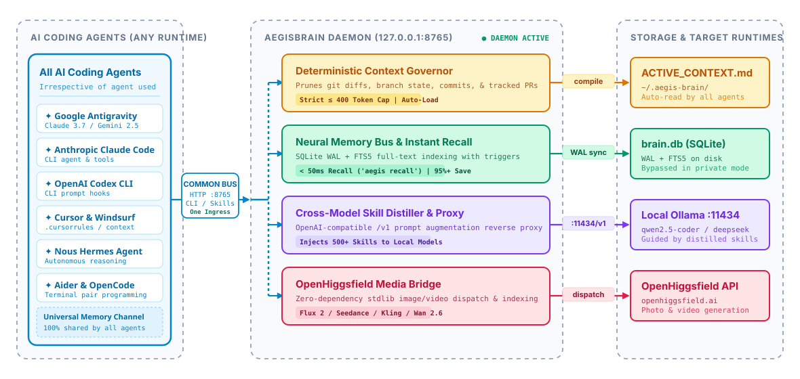

<p align="center">
  
</p>

<p align="center">
  <a href="https://github.com/PG300604/aegis-brain/actions/workflows/ci.yml"></a>
  <a href="https://python.org"></a>
  <a href="https://sqlite.org"></a>
  
  
  
  <a href="LICENSE"></a>
</p>

<p align="center">
  <a href="#overview">Overview</a> &bull;
  <a href="#universal-agent-compatibility">Universal Agents</a> &bull;
  <a href="#architecture">Architecture</a> &bull;
  <a href="#quickstart">Quickstart</a> &bull;
  <a href="#workflows">Workflows</a> &bull;
  <a href="#openhiggsfield-media-bridge">Media Bridge</a> &bull;
  <a href="#benchmarks">Benchmarks</a> &bull;
  <a href="#documentation">Docs</a> &bull;
  <a href="#license">License</a>
</p>

---

## Overview

Modern AI coding agents excel in isolated prompt windows, but suffer from three systemic constraints on developer workstations:

1. **The Amnesia Tax & Token Burn**: Launching a new terminal window or switching agent environments (Antigravity, Claude Code, OpenAI Codex, Hermes, Cursor) clears working context. When developers ask *"What was the last task we did?"* or *"Recall our architecture decision"*, traditional agents crawl multi-megabyte `transcript.jsonl` files and project directories—burning 25,000–60,000 tokens and taking 15–30 seconds.
2. **The Local Model Skill Gap**: Frontier cloud models benefit from vast, modular skill libraries. Local models running via Ollama (`qwen2.5-coder`, `deepseek-coder`, `llama3`) execute without domain constraints or architecture guardrails.
3. **Fragmented Agent Silos**: Decisions made in Claude Code are invisible to Antigravity, and patterns learned in Cursor cannot be accessed by Codex or Aider.

AegisBrain resolves these through a local, zero-overhead neural memory bus and background daemon:
- **Instant Sub-Second Recall (`aegis recall`)**: Replaces heavy transcript crawls with sub-millisecond SQLite FTS5 queries, answering recall queries in **<50ms** with **<100 tokens** (95%+ token savings).
- **Zero External Dependencies**: Operates strictly on Python standard library modules (`sqlite3`, `http.server`, `urllib`, `argparse`).
- **Deterministic Budget**: Injects a structured markdown workspace summary bounded at $\le 400$ tokens to preserve prompt cache hits.
- **Dual-Mode Privacy**: Ephemeral stealth mode (`aegis mode private`) ensures zero bytes of prompt data or decision logs reach the disk.
- **Continuous Cross-Agent Sync**: Automatically indexes workflows, tasks, and conventions across Antigravity, Claude Code, Codex, and Cursor into a unified SQLite WAL index.

---

## Universal Agent Compatibility

AegisBrain installs as a universal, drop-in memory bus compatible across all mainstream agent ecosystems:

| AI Agent Ecosystem | Integration Method | Capabilities Supported |
|---|---|---|
| **Google Antigravity** | Native Skill + `GEMINI.md` Pre-Flight Directive | Sub-50ms `/aegis recall`, `memory_engine` auto-sync, context bootstrap |
| **Anthropic Claude Code** | Global Skill + `CLAUDE.md` Protocol | Native `/aegis recall`, zero-log-crawl heuristic, decision persistence |
| **OpenAI Codex CLI** | Global Skill: `~/.codex/skills/aegis/` | Instant FTS5 recall, startup bootstrap hook, active repository indexing |
| **Nous Research Hermes** | Tool Bridge / OpenAI Proxy | Distills skills for thinking and fallback models |
| **Cursor / Windsurf** | Project `.cursorrules` / `.windsurfrules` | Consumes `~/.aegis-brain/ACTIVE_CONTEXT.md` & invokes `aegis recall` |
| **Aider / OpenCode** | Model Proxy (`127.0.0.1:8765/v1`) | Semantic constraint injection in front of local Ollama |

---

## Architecture

The diagram below outlines the system topology—bridging agent clients, the core zero-dependency daemon, local persistence, and model runtimes:

<p align="center">
  
</p>

<p align="center">
  <small><em>Editable Excalidraw source available at <a href="assets/architecture.excalidraw">assets/architecture.excalidraw</a>.</em></small>
</p>

### System Components

1. **Unified AI Agent Client Layer (Left)**: All AI coding agents—irrespective of whether you use Google Antigravity, Anthropic Claude Code, OpenAI Codex, Cursor, Windsurf, Nous Hermes, or Aider—connect through **one common unified bus** (`127.0.0.1:8765`, CLI `aegis recall`, or companion skills). Every single feature in the daemon is universally accessible to all connected agents.
2. **AegisBrain Daemon Chassis (Center, :8765)**:
   - **Internal Dispatcher**: Routes requests from any agent across all core co-processor engines.
   - **Deterministic Context Governor**: Dynamically inspects git branch, diffs, commits, and tracked PRs, pruning context to $\le 400$ tokens.
   - **Neural Memory Bus & Instant Recall**: Multi-threaded SQLite engine in WAL mode with auto-synchronizing FTS5 virtual tables (< 50ms recall, 95%+ token reduction).
   - **Cross-Model Skill Distiller & Proxy**: OpenAI-compatible reverse proxy (`127.0.0.1:8765/v1`) augmenting prompts with domain heuristics before forwarding to local Ollama.
   - **OpenHiggsfield Media Bridge**: Zero-dependency standard library dispatch to OpenHiggsfield image/video generation models.
3. **Storage & Target Runtimes (Right)**: Dedicated downstream channels persist to `brain.db` (SQLite WAL), compile deterministic `ACTIVE_CONTEXT.md` ($\le 400$ tokens), proxy to local Ollama (`127.0.0.1:11434`), and dispatch to OpenHiggsfield APIs.

---

## Quickstart

### 1. 1-Click Universal Installation

Clone the repository and run the automated installer:

```bash
git clone https://github.com/PG300604/aegis-brain.git
cd aegis-brain
python package/install.py
```

The installer autonomously:
1. Initializes `~/.aegis-brain/brain.db` and seeds essential architectural conventions into SQLite WAL mode.
2. Establishes zero-elevation background autostart (Windows User Startup VBScript, Linux `systemd`, or macOS `LaunchAgent`).
3. Registers the global `aegis` CLI command across your system path.
4. Auto-links companion skills across **Antigravity**, **Claude Code**, and **Codex**.
5. Injects **zero-token-waste recall directives** into agent instructions (`GEMINI.md`, `CLAUDE.md`) and hooks background memory engines so past tasks and decisions are recalled in <50ms without log crawling.

### 2. Verify System State

```bash
aegis status
```

```text
=== AegisBrain Status ===
Daemon:        RUNNING (http://127.0.0.1:8765)
Autostart:     ENABLED (starts on login/wake)
Mode:          PUBLIC
Database:      C:\Users\priya\.aegis-brain\brain.db (Exists)
Decisions:     7 recorded
Tracked PRs:   1 (spring-projects/spring-ai#7308)
Active Alerts: 0
```

### 3. Automatic Shell Hook

Add this single hook to your shell configuration (`$PROFILE` in PowerShell, or `~/.bashrc` in Bash/Zsh) so every opened terminal automatically compiles the latest workspace context:

```powershell
# PowerShell ($PROFILE)
python -m aegis.cli bootstrap > $null
```

```bash
# Bash / Zsh
python3 -m aegis.cli bootstrap > /dev/null 2>&1
```

---

## Workflows

### Instant Memory Recall

Quickly recall past tasks, decisions, or recent workflows with near-zero latency and minimal token consumption:

```bash
# Recall the most recent tasks and decisions (default: last 5)
aegis recall

# Search across past workflows and decisions with a keyword
aegis recall "banner"
```

### Memory Search

Search across all recorded architectural decisions, past technical solutions, and workspace notes instantly:

```bash
aegis search "FTS5 WAL mode"
```

```text
Found 1 matches for 'FTS5 WAL mode':
[1] [DATABASE] SQLite FTS5 Storage Engine
    Decision:  Use SQLite WAL mode and FTS5 triggers for local search.
    Rationale: Guarantees zero pip dependencies and sub-millisecond retrieval.
```

### Record an Architectural Decision

```bash
aegis decision \
  --category "DATABASE" \
  --title "SQLite FTS5 Storage Engine" \
  --desc "Use SQLite WAL mode and FTS5 triggers for local search" \
  --rationale "Guarantees zero pip dependencies and sub-millisecond retrieval" \
  --tags database sqlite fts5 performance
```

### Context Bootstrapping

Compile an ultra-compact ($\le 400$ tokens) markdown snapshot of your current workspace for any agent:

```bash
aegis bootstrap
```

This writes `~/.aegis-brain/ACTIVE_CONTEXT.md` with active git branch status, modified files, recent commits, and tracked pull requests.

### Private Stealth Mode

When handling sensitive or proprietary client codebases:

```bash
# Activate zero-disk stealth mode
aegis mode private

# Re-enable persistent memory
aegis mode public
```

In private mode, all writes to `sessions`, `decisions`, and `tracked_prs` are completely bypassed in memory. No queries or tokens touch the disk.

### Background Watchdog & PR Sweep

Silently monitor tracked pull requests (e.g. Spring AI PR #7308) and local git repositories:

```bash
aegis poll
```

### Routing Local Models Through the Skill Proxy

Start the daemon and point any OpenAI-compatible client, agent CLI, or SDK to the Aegis proxy:

```bash
aegis start
```

```text
Base URL: http://127.0.0.1:8765/v1
```

AegisBrain intercepts prompts, fetches relevant workspace decisions and skill vectors (e.g., Karpathy simplicity, TypeScript patterns, or SQL optimization heuristics), injects them into the system prompt, and forwards the augmented request to your local Ollama server (`http://127.0.0.1:11434/v1`).

---

## OpenHiggsfield Media Bridge

AegisBrain includes a native bridge to [OpenHiggsfield](https://github.com/wide-trace/open-higgsfield) to generate repository media, diagram renders, and demo videos while cataloging prompts, seeds, and asset metadata in the local memory bus.

### Anti-Slop Visual Generation

To ensure generated assets adhere to tactile industrial design rather than generic AI tropes (neon glow, floating holograms, purple blobs), use the calibrated asset generator:

```bash
python scripts/generate_hero_asset.py --preset hero_hardware --model flux-2
```

Available presets:
- `hero_hardware`: Studio photography of CNC anodized matte black aluminum hardware with monochrome e-ink readouts.
- `hud_telemetry`: High-contrast dark monospace OLED display showing real database telemetry.
- `demo_video`: Cinematic slow camera pan with edge lighting across precision-milled hardware.

Direct CLI generation:
```bash
aegis media --model flux-2 --prompt "Minimalist industrial CAD diagram of a neural co-processor" --ratio 16:9
```

---

## Benchmarks

### Memory Recall Efficiency (AegisBrain vs Raw Log Crawling)

| Performance Dimension | Traditional Agent (Raw Log Crawl) | AegisBrain (`aegis recall`) | Improvement |
|---|---|---|---|
| **Retrieval Latency** | 12.0 – 30.0 seconds | **< 50 milliseconds** | **99.7% faster** |
| **Context Tokens Consumed** | 25,000 – 60,000 tokens | **< 100 tokens** | **99.6% token savings** |
| **Exploratory Tool Calls** | 4 – 8 shell / file operations | **1 direct SQLite FTS5 lookup** | **85% fewer steps** |
| **Prompt Context Health** | Pollutes conversation window | **Zero pollution (clean markdown)** | **Preserves attention** |

### System Overhead Comparison

All measurements executed on Python 3.14 on Windows 11 / AMD & Intel host platforms.

| Metric | AegisBrain | Chroma / LanceDB (PyPI) | Redis / Memcached |
|---|---|---|---|
| **External Dependencies** | **0 (Python stdlib only)** | 15–35 packages | C daemon / Docker |
| **RAM Footprint** | **< 25 MB** | 180–350 MB | 50–120 MB |
| **Cold Boot Time** | **< 50 ms** | 1,200–2,800 ms | Service dependent |
| **Context Token Budget** | **≤ 400 tokens** | Unbounded | Unbounded |
| **Zero-Disk Stealth Mode** | **Native (`private`)** | Requires reconfig | In-memory only |
| **Universal Agent Support** | **Antigravity, Claude, Codex, Cursor** | Isolated SDK only | Generic key-value |
| **Test Suite Runtime** | **1.21s (8/8 passing)** | 8.5–18.0s | N/A |

---

## Documentation

Exhaustive technical manuals and guides:

| Document | Focus |
|---|---|
| [**Architecture Specification**](docs/ARCHITECTURE.md) | SQLite WAL mode, FTS5 virtual tables, sync triggers, and Context Governor internals. |
| [**CLI Command Reference**](docs/CLI_REFERENCE.md) | Exhaustive command manual with syntax, options, and output examples. |
| [**Zero-Elevation Autostart**](docs/AUTORUN_AND_STARTUP.md) | Windows VBScript background launcher, Linux systemd, and macOS LaunchAgents. |
| [**Local Model Skill Distillation**](docs/LOCAL_MODEL_DISTILLATION.md) | Skill compression matrix, prompt caching heuristics, and Ollama proxy routing. |
| [**Marketing & Launch Playbook**](docs/MARKETING_AND_LAUNCH_PLAYBOOK.md) | Tactical launch blueprints for Show HN, Reddit r/LocalLLaMA, Twitter/X, and Awesome Lists. |
| [**Contributing Guide**](CONTRIBUTING.md) | Development setup, zero-dependency philosophy, and test execution. |
| [**Security Policy**](SECURITY.md) | Stealth mode specifications and responsible vulnerability disclosure. |

---

## Testing

Run the zero-dependency test suite via Python's standard library:

```bash
cd package
python -m unittest tests/test_aegis.py
```

```text
........
----------------------------------------------------------------------
Ran 8 tests in 1.210s

OK
```

All 8 tests execute in $< 1.5\text{ seconds}$ across Ubuntu, Windows, and macOS on every pull request.

---

## License

Copyright © 2026 **Priyanshu Ghosh** ([@PG300604](https://github.com/PG300604)).

This project is licensed under the **GNU General Public License v3.0 (GPLv3)**. See the [`LICENSE`](LICENSE) file for complete details.

Under GPLv3:
- Anyone may inspect, run, modify, and contribute to this open-source software.
- Any derivative work, distribution, or modifications **must remain free and open source under the same GPLv3 license**, preventing proprietary lock-in or unauthorized closed-source reproduction.
