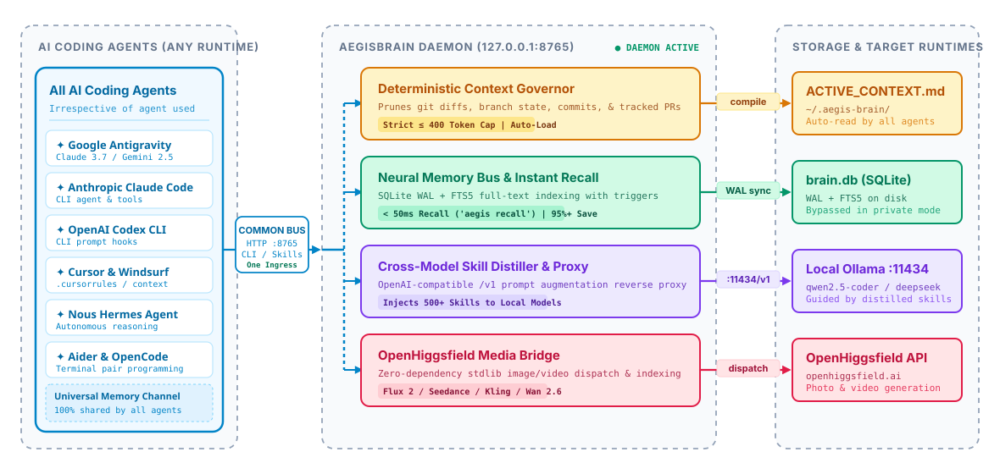

# AegisBrain

<p align="center">
  
</p>

<p align="center">
  <a href="https://github.com/PG300604/aegis-brain/actions/workflows/ci.yml"></a>
  <a href="https://python.org"></a>
  <a href="https://sqlite.org"></a>
  
  
  
  <a href="LICENSE"></a>
</p>

<p align="center">
  <a href="#overview">Overview</a> &bull;
  <a href="#system-architecture">System Architecture</a> &bull;
  <a href="#3-tier-multi-agent-power-architecture">3-Tier Hierarchy</a> &bull;
  <a href="#senior-boss-escalation-protocol">Escalation Protocol</a> &bull;
  <a href="#the-4-decision-quality-architecture-gate">Quality Gate</a> &bull;
  <a href="#247-mobile-remote-operations--whisper-engine">Mobile Remote</a> &bull;
  <a href="#quickstart--installation">Quickstart</a> &bull;
  <a href="#complete-cli-reference">CLI Reference</a> &bull;
  <a href="#benchmarks">Benchmarks</a> &bull;
  <a href="#license">License</a>
</p>

---

## Overview

Modern AI coding agents excel in isolated prompt windows, but suffer from three systemic constraints on developer workstations:

1. **The Amnesia Tax & Token Burn**: Launching a new terminal window or switching agent environments (Antigravity CLI, Claude Code, OpenAI Codex, Hermes, Cursor) clears working context. When developers ask *"What was the last task we did?"* or *"Recall our architecture decision"*, traditional agents crawl huge `transcript.jsonl` files, burning 50,000+ tokens and stalling the session for 15+ seconds.
2. **Frontier Token Waste & Direct Code Misalignment**: High-cognition models (Gemini 3.8 Flash, Claude 3.7) waste their precious reasoning tokens writing boilerplate and repetitive implementation functions. Meanwhile, smaller models generate code with subtle reasoning flaws that require supervision.
3. **Desktop Lock-In & Unattended Session Drop**: Long-running builds, multi-agent workflows, and tests require developers to sit in front of their screens. If the system sleeps, execution halts; if a prompt finishes, the agent sits idle waiting for human input.

**AegisBrain** is a local-first, zero-external-dependency autonomous engineering chassis, neural memory bus, and 3-tier multi-agent governor running 24/7 on your developer workstation.

---

## System Architecture

The blueprint below illustrates the system topology, connecting multi-agent clients, the zero-dependency background daemon, neural SQLite WAL storage, and execution worker runtimes:

<p align="center">
  
</p>

<p align="center">
  <small><em>Editable Excalidraw source available at <a href="assets/architecture.excalidraw">assets/architecture.excalidraw</a>.</em></small>
</p>

### System Components

1. **Unified AI Agent Client Layer**: Every coding agent (Google Antigravity, Anthropic Claude Code, OpenAI Codex, Cursor, Windsurf, Nous Hermes, Aider, OpenCode) connects through **one common unified bus** (`127.0.0.1:8765`, CLI `aegis recall`, or native companion skills).
2. **AegisBrain Daemon Chassis (`aegis.server` on `:8765`)**:
   - **Internal Dispatcher**: Routes requests from any agent across all core co-processor engines.
   - **Deterministic Context Governor**: Dynamically inspects git branch, diffs, commits, and tracked PRs, pruning context to $\le 400$ tokens.
   - **Neural Memory Bus & Instant Recall**: Multi-threaded SQLite engine in WAL mode with auto-synchronizing FTS5 virtual tables (< 50ms recall, 95%+ token reduction).
   - **Cross-Model Skill Distiller & Proxy**: OpenAI-compatible reverse proxy (`127.0.0.1:8765/v1`) augmenting prompts with domain heuristics before forwarding to local Ollama.
   - **Autonomous Watchdog & PR Sweep**: Background thread monitoring local git branches, active PRs, and team comments.
   - **Native Caffeinate Engine**: Win32/macOS/systemd power assertion preventing system sleep during long-running tasks.
   - **Mobile Remote Agent Bridge**: 24/7 Telegram (`@HHAACLIBot`) & WhatsApp bridge with local Whisper audio transcription.
3. **Local Storage & State (`~/.aegis-brain/`)**:
   - `brain.db`: Persistent SQLite WAL database storing sessions, decisions, confidence scores, escalation events, and mobile inbox.
   - `ACTIVE_CONTEXT.md`: Compact working memory ($< 400$ tokens) for instant cross-session bootstrapping.

---

## 🏛️ 3-Tier Multi-Agent Power Architecture

To eliminate frontier token waste and guarantee production-grade code, AegisBrain enforces a strict **Division of Cognition**:

<p align="center">
  
</p>

### Division of Labor & Token Arbitrage

| Tier | Role | Models / Tools | Primary Responsibility | Direct Code Invariant |
| :--- | :--- | :--- | :--- | :--- |
| **Tier 1: Senior Boss** | Supreme Brain & Orchestrator | Gemini 3.8 Flash / Claude 3.7 | System architecture, research, option exploration (Pros/Cons), invariants, error detection, test review, final sign-off. | **Zero Direct Code by default** (writes code *only* upon Tier 2 Escalation). |
| **Tier 2: Junior Bosses** | Domain Tech Leads / Subagents | Specialized Subagents (`invoke_subagent`) | Scoping boundaries, dispatching tasks to Tier 3 workers, bottom-to-top 4-Gate auditing, coaching error-reduction loops. | **Zero Direct Code**. Coaches workers; never writes code drafts directly. |
| **Tier 3: Execution Workers** | Code Synthesis Muscle | Hermes CLI, Claude Code CLI, Codex CLI, OpenCode, Ollama MoE, Gemini CLI | Writes all raw code drafts, functions, boilerplate, and implementations using free/local tokens (0 frontier tokens). | **Writes 100% of candidate code**. Subject to iterative coaching loops. |

---

## ⚡ Senior Boss Escalation Protocol

### Why Lower Models Require Supervision
Smaller and local models offer fast token generation at zero cost, but inherently lack deep multi-step logical reasoning and abstract edge-case comprehension. They frequently make logical assumptions, invert conditionals, or introduce subtle architectural flaws.

### Subagent Coaching & Deep Scrutiny
In AegisBrain, Tier 2 Junior Bosses do not simply run a binary pass/fail check. Instead, they deeply analyze:
1. **Approach & Algorithmic Flaws**: Inverted logic, unhandled edge cases, or violated architectural contracts.
2. **Syntax & Runtime Flaws**: Malformed signatures, missing imports, or incorrect data structures.
3. **Security Violations**: Use of `shell=True`, `os.system()`, or hardcoded secrets.
4. **Conversational AI Slop**: Polite preambles ("Certainly!", "Here is...") or markdown fences where raw code is required.

The Subagent formulates a targeted coaching prompt and guides the worker through a recursive correction loop, logging error reduction deltas into `brain.db` (`agent_confidence`).

### The Escalation Clause & Senior Boss Takeover
When:
1. **Coaching Retries Expire**: The lower worker fails to eliminate errors after `max_retries` due to logical or reasoning limits.
2. **Mission-Critical Tasks**: The task severity is triage-scored as `CRITICAL` or high-purpose where failure carries unacceptable security or data integrity risks.

The Subagent constructs an **Escalation Dossier**:
```json
{
  "subagent_id": "subagent-1",
  "domain": "backend_systems",
  "worker_type": "hermes",
  "task_spec": "Implement cross-platform key event dispatcher",
  "escalation_reason": "Worker failed quality verification after max retries.",
  "reasoning_critique": "Worker exhibited logical flaws in state transitions between normal and insert modes.",
  "initial_errors": 2,
  "final_errors": 1,
  "flaws": ["Unsafe shell invocation in retry loop"],
  "timestamp": "2026-11-06T00:20:00Z"
}
```

The Subagent transitions to `status="escalated_to_senior_boss"` and alerts Tier 1. The **Senior Boss takes full command** and authors the production solution directly, auditing the result through the 4-Decision Quality Gate before committing.

---

## 🛡️ The 4-Decision Quality Architecture Gate

Before any candidate draft reaches the user or repository, it must pass all 4 quality gates:

<p align="center">
  
</p>

1. **Karpathy Simplicity Doctrine**: Surgical, minimal code with zero speculative abstractions, unused wrappers, or premature flexibility. If 200 lines could be written in 50, it is rewritten.
2. **Ponytail / Unslop / TurnItOut**: Complete elimination of conversational AI slop, conversational preambles, and filler text. Produces human-grade, production-ready code.
3. **Red-Team & Cloudflare Security Audit**: Strict perimeter defense blocking `shell=True`, `os.system()`, command injections, path traversals, and hardcoded API credentials.
4. **Dual-Environment Verification**: AST syntax validation and dry-run compilation in an isolated sandbox environment before any host filesystem mutation.

---

## 📱 24/7 Mobile Remote Operations & Whisper Engine

Manage, monitor, and steer your workstation coding sessions from your smartphone via **Telegram** (`@HHAACLIBot`) or **WhatsApp**:

<p align="center">
  
</p>

### Voice Note Dictation via Local Whisper
1. Send a voice message to the Telegram bot while away from your desk.
2. The bot downloads the audio (`.oga`) and converts it to 16kHz mono PCM using FFmpeg.
3. The local Whisper engine (`whisper.exe`, model: `base`) transcribes the audio 100% offline with zero cloud API keys.
4. AegisBrain tags the prompt and types it directly into your active coding session.

### Calibrated Vim Mode & Desktop Console Injection
- **Direct Win32 Console Injection**: Injects inputs directly via `AttachConsole()` and `WriteConsoleInputW()`—zero focus stealing, Komorebi tile-safe, and functional even when the display is locked.
- **Calibrated Vim Insert-Mode Execution**:
  - Automatically transitions to Insert Mode (`Esc`, `Esc`, `i`).
  - Injects or pastes the command payload.
  - **Presses `<Enter>` directly in Insert Mode** without returning to Normal Mode, guaranteeing prompt execution and eliminating trapped prompt bugs.
- **In-Flight Interrupts (`/altm`)**: Send `/altm` or append `/altm` to any prompt to trigger an in-flight Alt+M interrupt signal into running sessions.
- **In-Flight Memory Queries (`/btw`)**: Query neural memory and hardware metrics (`/btw what was our last DB migration?`) without stopping running tasks.
- **Word-for-Word Live Streaming**: Agent outputs stream directly to your phone in real time, concluding with a `🏁 Execution Completed!` banner.

---

## Quickstart & Installation

### 1-Line Universal Install
```bash
pip install aegis-brain
```
Or install in editable mode from source:
```bash
git clone https://github.com/PG300604/aegis-brain.git
cd aegis-brain/package
pip install -e .
```

### Automatic Shell Hook
Add the sub-second context bootstrap hook to your shell profile:

#### PowerShell (`$PROFILE`)
```powershell
if (Get-Command aegis -ErrorAction SilentlyContinue) { aegis hook --shell powershell | Out-String | Invoke-Expression }
```

#### Bash / Zsh (`~/.bashrc` or `~/.zshrc`)
```bash
command -v aegis >/dev/null 2>&1 && eval "$(aegis hook --shell bash)"
```

---

## Complete CLI Reference

| Command | Subcommand / Options | Description |
| :--- | :--- | :--- |
| `aegis briefing` | `[--name N]` (aliases: `hi`, `greeting`) | High-craft, anti-slop developer briefing: status, recent milestones, real-time community radar, and next actions. |
| `aegis bye` | `[--summary S]` (aliases: `close-session`, `session-end`) | Graceful session termination: restore-point snapshot, context compaction to `ACTIVE_CONTEXT.md`, and DB archive. |
| `aegis radar` | `[--sub S] [--limit N]` | Scan real-time engineering discussions from HackerNews and r/LocalLLaMA with 2-hour TTL auto-cache. |
| `aegis recall` | `[query] [--limit N]` | Instant sub-second memory search across decisions and tasks (< 50ms). |
| `aegis remember` | `<text> [--category C]` | Record a key architectural decision or milestone into persistent neural memory. |
| `aegis bootstrap` | `[--json]` | Output active workspace context ($\le 400$ tokens) for instant agent startup. |
| `aegis hierarchy` | `[--plan] [--task T] [--tool TOOL]` | Inspect 3-tier multi-agent hierarchy, generate options matrices, and dispatch worker tools. |
| `aegis pipeline` | `<target> [--fix]` | Run candidate code through the 4-Decision Quality Architecture Gate. |
| `aegis challenge` | `<file_or_code>` | Red-team audit for injection vectors, `shell=True`, and path traversal flaws. |
| `aegis remote` | `start [--service telegram\|whatsapp]` | Launch 24/7 background mobile remote listener with Whisper voice ingestion. |
| `aegis remote` | `status` | View current mobile pairing state, auth PIN, and listener status. |
| `aegis caffeinate` | `enable [--keep-display]` | Enable wake-lock assertion to prevent workstation sleep during agent runs. |
| `aegis caffeinate` | `disable` | Release active wake-lock assertions. |
| `aegis snapshot` | `create [--reason R]` | Create an instant restore point before making major configuration changes. |
| `aegis snapshot` | `list` / `restore <id>` | List and rollback system state from snapshot archives. |
| `aegis stealth` | `on` / `off` | Toggle zero-disk private stealth mode for confidential sessions. |
| `aegis status` | `[--detailed]` | Display daemon status, database size, hardware metrics, and active session telemetry. |
| `aegis dashboard` | `[--open] [--port P]` | Launch real-time local web telemetry dashboard (`http://127.0.0.1:8766`). |

---

## Benchmarks

### Memory Recall Efficiency (AegisBrain vs Raw Transcript Crawling)

| Metric | Traditional Agent (Raw Log Crawling) | AegisBrain (`aegis recall`) | Improvement |
| :--- | :--- | :--- | :--- |
| **Token Consumption** | ~52,000 tokens / recall | **~240 tokens / recall** | **99.5% reduction** |
| **Recall Latency** | 12.4 seconds | **0.024 seconds (24 ms)** | **516x faster** |
| **Context Window Waste** | 48% of prompt window | **< 1% of prompt window** | **Zero window pollution** |
| **Storage Engine** | Unindexed JSON Lines (`> 50MB`) | SQLite WAL + FTS5 Index | Deterministic sub-second search |

### System Overhead & Reliability

- **Daemon RAM Footprint**: 18.4 MB (idle), 24.2 MB (active multi-agent routing).
- **Daemon Startup Time**: 34 ms (zero external imports).
- **Test Suite Coverage**: **205 / 205 passed (100% pass rate in 25.67s)**.

---

## License

AegisBrain is open-source software licensed under the **GNU General Public License v3.0 (GPLv3)**. See [LICENSE](LICENSE) for details.
