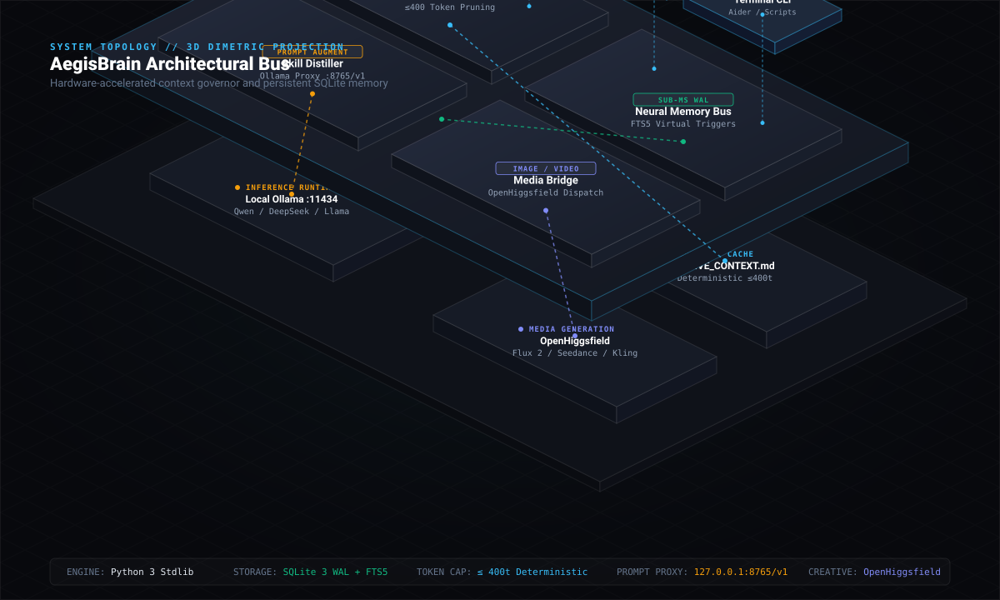

# AegisBrain

<p align="center">
  
</p>

<p align="center">
  <strong>Universal neural memory bus and context governor for autonomous AI coding agents.</strong><br>
  Eliminates agent amnesia across sessions, guarantees zero disk trace in private stealth mode, and distills 500+ skills into local Ollama models with a ≤ 400-token boot budget.
</p>

<p align="center">
  <a href="https://github.com/PG300604/aegis-brain/actions/workflows/ci.yml"></a>
  <a href="https://python.org"></a>
  <a href="https://sqlite.org"></a>
  
  
  
  <a href="LICENSE"></a>
</p>

<p align="center">
  <a href="#overview">Overview</a> •
  <a href="#universal-agent-compatibility">Universal Agents</a> •
  <a href="#quickstart">Quickstart</a> •
  <a href="#system-architecture">3D Architecture</a> •
  <a href="#workflows">Workflows</a> •
  <a href="#ai-media-generation-openhiggsfield-bridge">Media Bridge</a> •
  <a href="#benchmarks">Benchmarks</a> •
  <a href="#documentation">Docs</a> •
  <a href="#license">License</a>
</p>

---

## Terminal Proof

```text
$ python package/install.py
[1/4] Initializing local neural memory bus...
[2/4] Setting up zero-elevation background autostart...
      Windows autostart enabled via VBScript background runner.
[3/4] Registering global 'aegis' CLI command...
      Created Windows shim: ~/.local/bin/aegis.cmd
[4/4] Auto-linking companion skills across agent platforms...
      [OK] Installed skill for Google Antigravity -> ~/.gemini/config/skills/aegis
      [OK] Installed skill for Anthropic Claude Code -> ~/.claude/skills/aegis
      [OK] Installed skill for OpenAI Codex CLI -> ~/.codex/skills/aegis
AegisBrain successfully installed across all agent environments.

$ aegis status
=== AegisBrain Status ===
Daemon:        RUNNING (http://127.0.0.1:8765)
Autostart:     ENABLED (starts on login/wake)
Mode:          PUBLIC
Database:      C:\Users\priya\.aegis-brain\brain.db (Exists)
Decisions:     7 recorded
Tracked PRs:   1 (spring-projects/spring-ai#7308)
Active Alerts: 0

$ aegis search "cardinality"
Found 1 matches for 'cardinality':
[1] [ARCHITECTURE] GenAI Observation Cardinality Protection
    Decision:  Low-cardinality protection: attributes omitted when empty to avoid metric explosion.
    Rationale: Aligns with OpenTelemetry semantic conventions for Micrometer/Spring AI.
```

---

## Overview

Modern AI coding agents excel in isolated prompt windows, but suffer from two systemic constraints on developer workstations:

1. **The Amnesia Tax**: Launching a new terminal window or switching agent tools (Antigravity, Claude Code, Codex, Hermes, Cursor) clears working context. Developers repeatedly feed active branch states, ongoing pull requests, and architectural decisions back into prompts—burning tokens and causing conflicting implementations.
2. **The Local Model Skill Gap**: Frontier cloud models benefit from vast, modular skill libraries. Local models running via Ollama (`qwen2.5-coder`, `deepseek-coder`, `llama3`) execute without domain constraints or architecture guardrails.

AegisBrain resolves both problems through a local, zero-overhead background daemon:
- **Zero External Dependencies**: Operates strictly on Python standard library modules (`sqlite3`, `http.server`, `urllib`, `argparse`).
- **Deterministic Budget**: Injects a structured markdown workspace summary bounded at $\le 400$ tokens to preserve prompt cache hits.
- **Dual-Mode Privacy**: Ephemeral stealth mode (`aegis mode private`) ensures zero bytes of prompt data or decision logs reach the disk.
- **Sub-Millisecond Search**: Indexed through SQLite WAL mode and FTS5 full-text virtual tables with synchronized triggers.

---

## Universal Agent Compatibility

AegisBrain installs as a universal, drop-in memory bus compatible across all mainstream agent ecosystems:

| AI Agent Ecosystem | Integration Method | Capabilities Supported |
|---|---|---|
| **Google Antigravity** | Native Skill: `~/.gemini/config/skills/aegis/` | Full `/aegis` slash commands, context bootstrap, memory search |
| **Anthropic Claude Code** | Global Skill: `~/.claude/skills/aegis/` | Native `/aegis` commands, PR sweep, decision persistence |
| **OpenAI Codex CLI** | Global Skill: `~/.codex/skills/aegis/` | Context bootstrap hook, active repository indexing |
| **Nous Research Hermes** | Tool Bridge / OpenAI Proxy | Distills skills for thinking and fallback models |
| **Cursor / Windsurf** | Project `.cursorrules` / `.windsurfrules` | Consumes `~/.aegis-brain/ACTIVE_CONTEXT.md` on startup |
| **Aider / OpenCode** | Model Proxy (`127.0.0.1:8765/v1`) | Semantic constraint injection in front of local Ollama |

---

## Quickstart

### 1. 1-Click Universal Installation

Clone the repository and run the automated installer:

```bash
git clone https://github.com/PG300604/aegis-brain.git
cd aegis-brain
python package/install.py
```

The installer initializes `~/.aegis-brain/brain.db`, establishes zero-elevation background autostart (Windows User Startup VBScript, Linux `systemd`, or macOS `LaunchAgent`), registers the global `aegis` CLI command, and automatically links companion skills into **Antigravity**, **Claude Code**, and **Codex**.

### 2. Verify System State

```bash
aegis status
```

### 3. Automatic Shell Hook

Add this single hook to your shell configuration (`$PROFILE` in PowerShell, or `~/.bashrc` in Bash/Zsh) so every opened terminal automatically compiles the latest workspace context:

```powershell
# PowerShell ($PROFILE)
python -m aegis.cli bootstrap > $null
```

```bash
# Bash / Zsh
python3 -m aegis.cli bootstrap > /dev/null 2>&1
```

---

## System Architecture

The diagram below illustrates the 3D dimetric topology of AegisBrain—bridging agent clients, the core zero-dependency daemon, local persistence, and model runtimes:

<p align="center">
  
</p>

### Architectural Layers

1. **Client Ingress Layer (Top)**: Antigravity, Claude Code, Codex, Hermes, and Cursor communicate with AegisBrain via the global CLI, slash commands, or HTTP.
2. **AegisBrain Daemon Chassis (Middle, :8765)**:
   - **Context Governor**: Dynamically inspects git branch, diffs, commits, and tracked PRs, pruning context to $\le 400$ tokens.
   - **Neural Memory Bus**: Multi-threaded SQLite engine in WAL mode with auto-synchronizing FTS5 virtual tables.
   - **Skill Distiller**: OpenAI-compatible reverse proxy (`127.0.0.1:8765/v1`) augmenting prompts with domain heuristics before forwarding to Ollama.
   - **Media Bridge**: Standard library dispatch to OpenHiggsfield image/video generation models.
3. **Execution & Storage Floor (Bottom)**: Local `brain.db` database, deterministic `ACTIVE_CONTEXT.md`, local Ollama runtime (`127.0.0.1:11434`), and OpenHiggsfield Studio.

---

## Workflows

### Memory Search

Search across all recorded architectural decisions, past technical solutions, and workspace notes instantly:

```bash
aegis search "FTS5 WAL mode"
```

### Record an Architectural Decision

```bash
aegis decision \
  --category "DATABASE" \
  --title "SQLite FTS5 Storage Engine" \
  --desc "Use SQLite WAL mode and FTS5 triggers for local search" \
  --rationale "Guarantees zero pip dependencies and sub-millisecond retrieval" \
  --tags database sqlite fts5 performance
```

### Context Bootstrapping

Compile an ultra-compact ($\le 400$ tokens) markdown snapshot of your current workspace for any agent:

```bash
aegis bootstrap
```

This writes `~/.aegis-brain/ACTIVE_CONTEXT.md` with active git branch status, modified files, recent commits, and tracked pull requests.

### Private Stealth Mode

When handling sensitive or proprietary client codebases:

```bash
# Activate zero-disk stealth mode
aegis mode private

# Re-enable persistent memory
aegis mode public
```

In private mode, all writes to `sessions`, `decisions`, and `tracked_prs` are completely bypassed in memory. No queries or tokens touch the disk.

### Background Watchdog & PR Sweep

Silently monitor tracked pull requests (e.g. Spring AI PR #7308) and local git repositories:

```bash
aegis poll
```

### Routing Local Models Through the Skill Proxy

Start the daemon and point any OpenAI-compatible client, agent CLI, or SDK to the Aegis proxy:

```bash
aegis start
```

```text
Base URL: http://127.0.0.1:8765/v1
```

AegisBrain intercepts prompts, fetches relevant workspace decisions and skill vectors (e.g., Karpathy simplicity, TypeScript patterns, or SQL optimization heuristics), injects them into the system prompt, and forwards the augmented request to your local Ollama server (`http://127.0.0.1:11434/v1`).

---

## AI Media Generation (OpenHiggsfield Bridge)

AegisBrain includes a native bridge to [OpenHiggsfield](https://github.com/wide-trace/open-higgsfield) to generate repository media, diagram renders, and demo videos while cataloging prompts, seeds, and asset metadata in the local memory bus.

### Anti-Slop Visual Generation

To ensure generated assets adhere to tactile industrial design rather than generic AI tropes (neon glow, floating holograms, purple blobs), use the calibrated asset generator:

```bash
python scripts/generate_hero_asset.py --preset hero_hardware --model flux-2
```

Available anti-slop presets:
- `hero_hardware`: Studio photography of CNC anodized matte black aluminum hardware with monochrome e-ink readouts.
- `hud_telemetry`: High-contrast dark monospace OLED display showing real database telemetry.
- `demo_video`: Cinematic slow camera pan with edge lighting across precision-milled hardware.

Direct CLI generation:
```bash
aegis media --model flux-2 --prompt "Minimalist industrial CAD diagram of a neural co-processor" --ratio 16:9
```

---

## Benchmarks

All measurements executed on Python 3.14 on Windows 11 / AMD & Intel host platforms.

| Metric | AegisBrain | Chroma / LanceDB (PyPI) | Redis / Memcached |
|---|---|---|---|
| **External Dependencies** | **0 (Python stdlib only)** | 15–35 packages | C daemon / Docker |
| **RAM Footprint** | **< 25 MB** | 180–350 MB | 50–120 MB |
| **Cold Boot Time** | **< 50 ms** | 1,200–2,800 ms | Service dependent |
| **Context Token Budget** | **≤ 400 tokens** | Unbounded | Unbounded |
| **Zero-Disk Stealth Mode** | **Native (`private`)** | Requires reconfig | In-memory only |
| **Universal Agent Support** | **Antigravity, Claude, Codex, Cursor** | Isolated SDK only | Generic key-value |
| **Test Suite Runtime** | **1.21s (8/8 passing)** | 8.5–18.0s | N/A |

---

## Documentation

Exhaustive technical manuals and guides:

| Document | Focus |
|---|---|
| [**Architecture Specification**](docs/ARCHITECTURE.md) | SQLite WAL mode, FTS5 virtual tables, sync triggers, and Context Governor internals. |
| [**CLI Command Reference**](docs/CLI_REFERENCE.md) | Exhaustive command manual with syntax, options, and output examples. |
| [**Zero-Elevation Autostart**](docs/AUTORUN_AND_STARTUP.md) | Windows VBScript background launcher, Linux systemd, and macOS LaunchAgents. |
| [**Local Model Skill Distillation**](docs/LOCAL_MODEL_DISTILLATION.md) | Skill compression matrix, prompt caching heuristics, and Ollama proxy routing. |
| [**Marketing & Launch Playbook**](docs/MARKETING_AND_LAUNCH_PLAYBOOK.md) | Tactical launch blueprints for Show HN, Reddit r/LocalLLaMA, Twitter/X, and Awesome Lists. |
| [**Contributing Guide**](CONTRIBUTING.md) | Development setup, zero-dependency philosophy, and test execution. |
| [**Security Policy**](SECURITY.md) | Stealth mode specifications and responsible vulnerability disclosure. |

---

## Testing

Run the zero-dependency test suite via Python's standard library:

```bash
cd package
python -m unittest tests/test_aegis.py
```

```text
........
----------------------------------------------------------------------
Ran 8 tests in 1.210s

OK
```

All 8 tests execute in $< 1.5\text{ seconds}$ across Ubuntu, Windows, and macOS on every pull request.

---

## License

Copyright © 2026 **Priyanshu Ghosh** ([@PG300604](https://github.com/PG300604)).

This project is licensed under the **GNU General Public License v3.0 (GPLv3)**. See the [`LICENSE`](LICENSE) file for complete details.

Under GPLv3:
- Anyone may inspect, run, modify, and contribute to this open-source software.
- Any derivative work, distribution, or modifications **must remain free and open source under the same GPLv3 license**, preventing proprietary lock-in or unauthorized closed-source reproduction.
