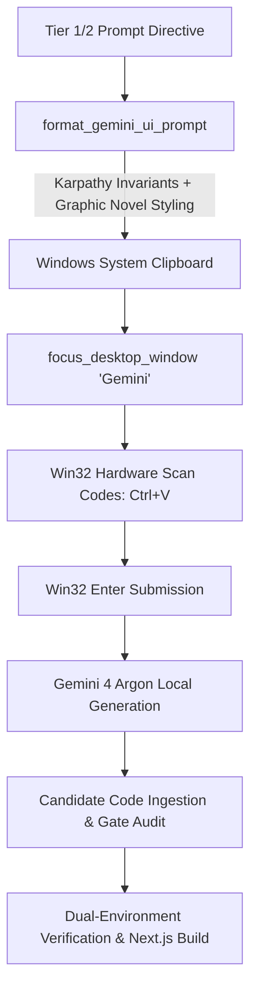

# Gemini Desktop Worker Bridge (Gemini 4 Argon Delegation)

## Overview

AegisBrain features a **Tier 3 Execution Worker Bridge** for delegating UI element generation, boilerplate synthesis, and design prototyping directly to the locally running **Gemini Desktop application** (`Gemini 4 Argon`).

This allows the system to achieve **$0.00 API token cost** by offloading heavy code generation to the local Gemini session while preserving Tier 1/2 frontier intelligence for architecture, invariants definition, and static safety gating.

---

## Host Architecture & Environment Facts

- **Host OS**: Windows 11 Pro
- **Gemini Desktop Executable**: `C:\Users\priya\AppData\Local\Google\Gemini\app-1.18.0\Gemini.exe`
- **Desktop Window Title**: `"Gemini"`
- **Bridge Script**: `P:\open-source\aegis-brain\scripts\gemini_desktop_worker.py`
- **Automation Engine**: `P:\open-source\aegis-brain\package\aegis\remote.py`

---

## 5-Stage Automation Lifecycle



1. **Prompt Formatting**: Injects the **Andrej Karpathy Simplicity Doctrine** (no speculative abstractions, single-file self-contained components) and **Aegis Graphic Novel Invariants** (high-contrast `#FAF8F5`/`#070709`, `border-2 border-black`, `shadow-[4px_4px_0px_#000000]`, no rounded red pills).
2. **Clipboard Staging**: Copies the structured prompt to the Windows clipboard via Win32 `OpenClipboard` / `SetClipboardData(CF_UNICODETEXT)`.
3. **Desktop Window Activation**: Finds and raises the `"Gemini"` window to foreground via `focus_desktop_window("Gemini")` and simulates a subtle click inside the input box to guarantee focus.
4. **Keystroke Simulation**: Emits hardware scan codes (`user32.keybd_event`) for `Ctrl+V` followed by `Enter`.
5. **Quality Gate & Integration**: The generated code is placed into `web/components/hud/` and verified with `npm run build` and pytest gates.

---

## CLI Usage

### 1. Preview Prompt (Dry Run)
Inspect the exact prompt that will be sent to Gemini Desktop without focusing the window:
```bash
python P:\open-source\aegis-brain\scripts\gemini_desktop_worker.py --preview --component Feature06StatsBadge
```

### 2. Copy Prompt to Clipboard Only
```bash
python P:\open-source\aegis-brain\scripts\gemini_desktop_worker.py --copy-only --component Feature06StatsBadge
```

### 3. Dispatch to Gemini Desktop and Submit
```bash
python P:\open-source\aegis-brain\scripts\gemini_desktop_worker.py --component Feature06StatsBadge
```

### 4. Paste without Pressing Enter (Review before Submitting)
```bash
python P:\open-source\aegis-brain\scripts\gemini_desktop_worker.py --component Feature06StatsBadge --no-enter
```

---

## Code Integration Pattern

Once Gemini 4 Argon completes code generation:
1. Copy the TSX code block into `P:\open-source\aegis-brain\web\components\hud\<ComponentName>.tsx`.
2. Export the component in `P:\open-source\aegis-brain\web\components\hud\index.ts`.
3. Import and render the component in `P:\open-source\aegis-brain\web\app\page.tsx`.
4. Run the Next.js compile check:
   ```bash
   npm --prefix P:\open-source\aegis-brain\web run build
   ```
5. Confirm `0 errors` and static page prerender status.
