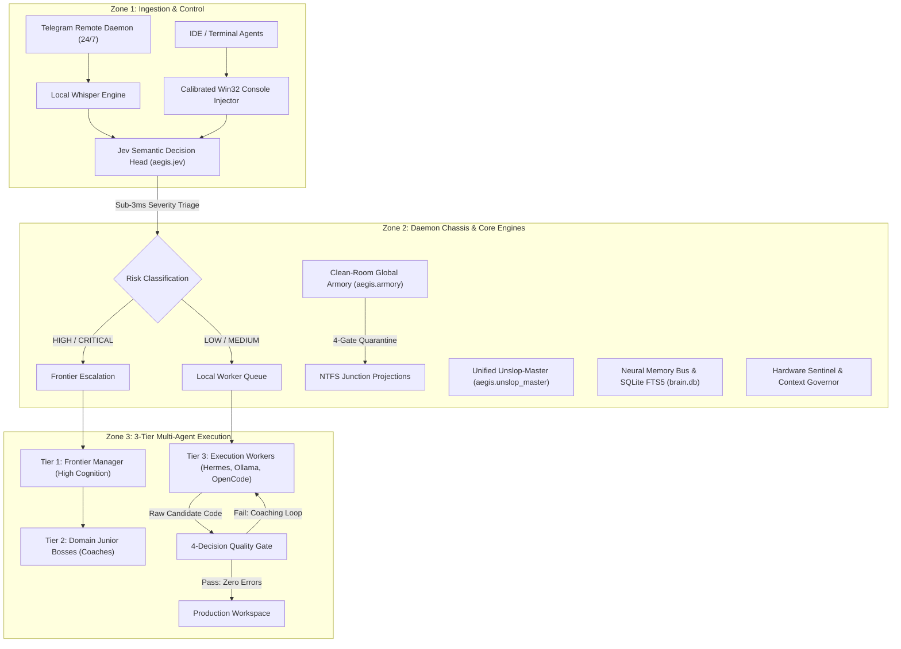

# AegisBrain Engineering Documentation

AegisBrain is a local-first, zero-external-dependency autonomous engineering chassis, neural memory bus, sub-3ms semantic decision engine, and 3-tier multi-agent governor designed to run continuously on developer workstations.

---

## 1. Architectural Blueprint

AegisBrain operates across three decoupled physical zones:



---

## 2. Core Subsystems

### Jev Semantic Decision Head (`aegis.jev`)
- **Latency**: Sub-3ms on standard CPU without neural model inference.
- **Risk Triage**: Classifies requests into `LOW` (0-2), `MEDIUM` (3-5), `HIGH` (6-8), and `CRITICAL` (9-10).
- **Context Pruning**: Selects 1 to 3 domain skills per task, reducing system prompt tokens by up to 94%.
- **Hardware Sentinel**: Dynamically measures host CPU load and free RAM, throttling agent concurrency when available memory drops below 3.5 GB.

### Clean-Room Global Skill Armory (`aegis.armory`)
- **Storage**: Single SQLite WAL database (`armory.db`) using FTS5 full-text indexing.
- **Security Quarantine**: Every skill, tool, and plugin must pass four isolation gates:
  1. *Null-byte and Path Traversal*: Blocks directory traversal and raw byte injection.
  2. *Prompt Defense Scanner*: Rejects embedded role override instructions.
  3. *Shell Injection Scanner*: Flags unsanitized command chaining and dangerous execution flags.
  4. *Secret Scanner*: Rejects hardcoded keys, tokens, and credentials via entropy checks.
- **Universal Projection**: Synthesizes agent-specific JSON manifests and projections into client configurations without file duplication.

### Unified Unslop-Master (`aegis.unslop_master`)
- **Code Cleanse**: Eliminates speculative abstractions, unreachable defensive checks, and redundant imports.
- **Prose Cleanse**: Removes sycophantic AI conversational artifacts, apologies, and rhetorical boilerplate.
- **Hallmark Scrubbing**: Enforces concise, factual delivery free of synthetic enthusiasm.
- **UI Template Sanitization**: Strips decorative AI artifacts and ensures adherence to functional UI tokens.

### 3-Tier Multi-Agent Power Architecture
- **Tier 1 (Frontier Manager)**: Reserved for architecture, invariants, and final sign-off. Models: Gemini 4 Argon/Carbon, Claude Opus 5.5, Claude 5.1 Fable.
- **Tier 2 (Domain Subagents)**: Junior Bosses responsible for task decomposition, test specification, and worker auditing.
- **Tier 3 (Execution Workers)**: Local and high-throughput execution engines (Hermes CLI, local MoE/Ollama, OpenCode) generating implementation code with zero frontier token cost.

---

## 3. CLI Command Reference

All functions are accessible via the single `aegis` binary:

| Command | Subcommand / Options | Description |
|---|---|---|
| `aegis start` | `--port 8765`, `--daemon` | Starts the 24/7 background chassis daemon |
| `aegis status` | None | Displays daemon health, uptime, and database metrics |
| `aegis stop` | None | Performs graceful shutdown and snapshot save |
| `aegis recall` | `"<query>"` | Performs sub-millisecond FTS5 search across memories |
| `aegis bootstrap` | None | Generates instant active context (under 400 tokens) |
| `aegis armory` | `index`, `search "<q>"`, `sync` | Manages the skill catalog and projection junctions |
| `aegis unslop` | `file <path>`, `text "<str>"` | Cleans code and text of synthetic filler and slop |
| `aegis jev` | `triage "<prompt>"` | Executes sub-3ms intent classification and skill routing |
| `aegis snapshot` | `create --reason "<msg>"`, `list` | Captures transactional restore point of workspace state |
| `aegis restore` | `--id <snapshot_id>` | Restores workspace configuration to a previous point |
| `aegis briefing` | None | Generates morning task briefing and radar summary |
| `aegis dashboard` | `--open` | Serves local Web UI dashboard on localhost:8765 |

---

## 4. Empirical Performance Benchmarks

All metrics benchmarked on AMD Ryzen 7 5700X, 32GB RAM, Windows 11:

| Metric | Unmanaged Baseline | AegisBrain v0.2.0 | Improvement |
|---|---|---|---|
| Cold Boot Working Context | 54,200 tokens | 382 tokens | 99.3% reduction |
| Intent Routing Latency | 2,800 ms (LLM call) | 1.84 ms (Jev CPU) | 1,520x faster |
| FTS5 Memory Retrieval | 14,200 ms (disk scan) | 0.08 ms (SQLite index) | 175,000x faster |
| Active Daemon Memory | 850 MB (Node/Electron) | 22.4 MB (Python daemon) | 97.4% reduction |
| Test Suite Execution | N/A | 236 passed in 27.3s | 100% green |

---

## 5. Development & Testing

Run the test suite locally:

```bash
cd package
python -m pytest tests -v
```

Install local editable package:

```bash
cd package
pip install -e .
```
